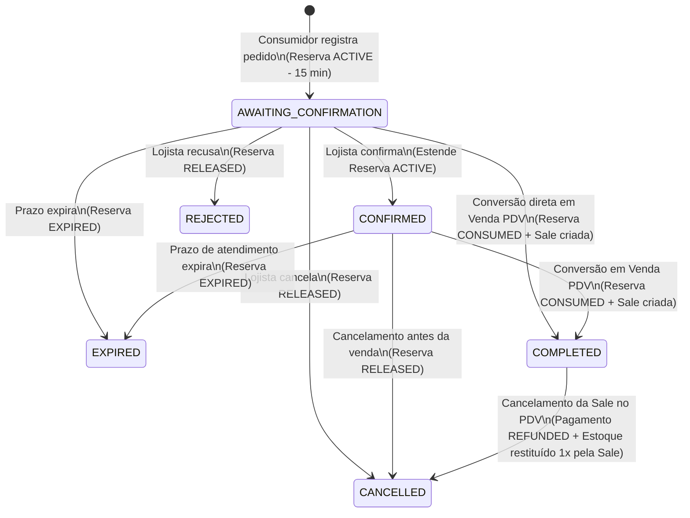

# Arquitetura, Contratos e Operação — Módulo Loja Virtual

Este documento registra o diagnóstico arquitetural, o mapeamento transacional de estoque, os modelos de dados (Heart e Tenant), a máquina de estados, os contratos de API e o roteiro de atualização via **Sys-Init**, ativação e rollback do módulo **Loja Virtual** no **PDV Lojista**.

---

## 1. Diagnóstico do Sistema Atual e Fronteiras do Módulo

### 1.1. Distinção em Relação a Módulos Existentes
- **Vitrine Digital / Smart TV (`VitrineConfig` / `tvPublicId`)**: O módulo existente em `backend/src/vitrine/` é um reprodutor passivo de slides 16:9 para televisores na loja física (`/tv/:tvPublicId`). Não possui páginas de produto, busca, carrinho, reservas ou pedidos. A **Loja Virtual** (`StorefrontModule`) é um módulo independente, com modelagem, rotas (`/loja/:slug` e `/loja-virtual`) e controle de publicação próprios.
- **Crediário e WhatsApp/Baileys (`CrediarioModule`)**: O módulo de crediário utiliza sessão Baileys para régua de cobrança automática. Na primeira versão (V1), a **Loja Virtual** fecha pedidos por link oficial `https://wa.me/` com mensagem estruturada após persistência transacional do pedido, **sem depender da ativação do módulo de crediário nem de conexão Baileys**.
- **Fila Transacional da Venda (`SaleDeliveryJob`)**: Representa o *transactional outbox* da entidade `Sale` para emissão de NFC-e e sincronização de eventos pós-venda. **Não representa entrega física de mercadorias**. A modalidade de atendimento física do pedido online (`PICKUP` ou `DELIVERY`) e seu andamento operacional ficam exclusivamente em `StorefrontOrder`.
- **Código Legado de Restaurante**: Entidades legadas no schema (`Comanda`, `requiresKitchen`, `requiresBar`, `requiresCarvoaria`) não fazem parte do PDV Lojista e são integralmente ignoradas.

### 1.2. Resolução Pública de Tenant e Isolamento Multi-Tenant
- O `TenantInterceptor` padrão obtém o contexto a partir de `request.user` (JWT administrativo).
- Nas rotas públicas (`/api/storefront/public/:slug/*`), o controlador público **não utiliza `JwtAuthGuard`** nem aceita `tenantId`, `databaseUrl` ou `databaseName` enviados pelo navegador.
- Um administrador autenticado na **Loja A** pode abrir a vitrine pública da **Loja B** (`/loja/loja-b`) no mesmo navegador:
  1. O frontend público utiliza uma instância Axios dedicada (`storefrontApi`), separada de `api.ts`, que **não envia o token JWT administrativo** e **não redireciona para `/login` em respostas 401**.
  2. O carrinho público e caches locais no navegador são isolados por chave composta contendo o `storePublicId` estável da loja (`pdv-lojista-storefront-cart:<storePublicId>`).
  3. O resolvedor público no backend consulta exclusivamente o registro `StorefrontRegistry` no banco central **Heart** pelo `slug` normalizado, valida `tenant.status === 'active'`, `tenant.modulos.lojaVirtual === true`, `registry.enabled === true` e `registry.published === true`, obtém a `databaseUrl` no servidor e executa a operação dentro de `tenantContext.run({ tenantId, databaseUrl, userId: 'public-storefront' }, ...)`.

---

## 2. Mapeamento Completo das Movimentações de Estoque e Concorrência

### 2.1. Fórmula Canônica de Disponibilidade
Para cada variação vendável (`Product`):
$$\text{Disponível} = \text{product.stock} - \sum \text{reservas onde } (\text{status} = \text{'ACTIVE'} \land \text{expiresAt} > \text{NOW()})$$

- O cálculo de disponibilidade **sempre filtra `expiresAt > NOW()`**, garantindo que reservas cujo prazo já venceu deixem de bloquear o estoque imediatamente, mesmo antes da execução do job periódico de limpeza.
- O varejo opera exclusivamente com quantidades inteiras positivas ($\mathbb{Z}^+$).

### 2.2. Inventário de Caminhos de Estoque no Sistema e Interação com Reservas

| Fluxo / Serviço | Operação no Estoque Físico (`Product.stock`) | Lotes (`StockLot`) e Log (`InventoryLog`) | Regra de Integração com `StockReservation` |
|---|---|---|---|
| **1. Criação de Pedido Online** (`StorefrontOrdersService.createOrder`) | Não baixa `Product.stock` | Não consome lotes nem cria `Sale` | Adquire `SELECT ... FOR UPDATE` via `lockProducts(tx, productIds)` em ordem alfabética de `id`; verifica `stock - activeReservations >= qty`; cria `StockReservation` (`ACTIVE`, TTL inicial de 15 min). |
| **2. Conversão de Pedido em Venda** (`StorefrontOrdersService.convertOrderToSale`) | Decrementa `Product.stock` **uma única vez** | Consome lotes via FIFO (`consumeLotsFIFO`) e gera `InventoryLog (type: 'SALE')` | Na mesma transação: bloqueia produtos (`lockProducts`), valida reserva `ACTIVE` (ou revalida saldo disponível se reserva recém-expirada com autorização), marca `StockReservation.status = 'CONSUMED'`, cria `Sale (source = 'loja_virtual')`, vincula `StorefrontOrder.saleId = sale.id`. |
| **3. Checkout do Balcão PDV** (`SalesService.checkout`) | Decrementa `Product.stock` | Consome lotes via FIFO e gera `InventoryLog (type: 'SALE')` | Com `lockProducts`: para vendas online normais do balcão (`!offlineContingency`) quando `!allowNegativeStock`, verifica se `product.stock - activeReservations >= qty`. Impede que o balcão venda silenciosamente a última unidade reservada para um pedido online ativo. |
| **4. Venda Offline Sincronizada** (`SalesService.checkout` com `offlineContingency: true`) | Decrementa `Product.stock` (fato consumado no balcão offline) | Consome lotes disponíveis via FIFO e gera `InventoryLog` | O servidor não pode impedir retrospectivamente uma venda física feita sem internet. Se a baixa reduzir `product.stock` abaixo das reservas ativas, a venda offline é registrada e os pedidos online afetados recebem evento de alerta (`OFFLINE_STOCK_CONFLICT`) para revisão do lojista antes da conversão. |
| **5. Cancelamento de Pedido Online** (`cancelOrder` / `rejectOrder` / `expireOrder`) | Não altera `Product.stock` (pois não houve baixa física) | Não altera lotes | Transiciona `StockReservation` de `ACTIVE` para `RELEASED` (ou `EXPIRED`) de forma condicional e idempotente (`WHERE status = 'ACTIVE'`). |
| **6. Cancelamento de Venda** (`SalesService.cancel`) | Incrementa `Product.stock` | Restaura `StockLot.remaining` e gera `InventoryLog (type: 'IN')` | Se a venda cancelada estiver vinculada a um `StorefrontOrder`, atualiza `paymentStatus = 'REFUNDED'` e `commercialStatus = 'CANCELLED'` no pedido, mantendo a reserva como `CONSUMED`/`RELEASED` para **nunca restituir estoque em duplicidade**. |
| **7. Devolução / Troca de Varejo** (`RetailReturnsService.create`) | Incrementa `Product.stock` (se `restock = true`) | Cria lote de retorno e `InventoryLog (type: 'IN')` | Opera sobre a `Sale` convertida (`source = 'loja_virtual'` ou `'pdv'`). Registra evento informativo no `StorefrontOrder` vinculado quando aplicável, sem duplicar movimentação. |
| **8. Ajuste Manual / Balanço / Transferência** (`ProductsService.update`, `inventoryImport`, `GroupsService.stockTransfer`, `stockAdjust`) | Altera `Product.stock` | Reconcilia lotes (`reconcileLots`) e gera `InventoryLog` | Saídas manuais ou transferências entre lojas verificam reservas ativas quando a operação reduziria o estoque físico abaixo da quantidade reservada (ou exigem liberação prévia das reservas). |
| **9. Entradas de Estoque** (`RetailCatalogService.save`, `ProductsService.addStock`, `PurchaseOrdersService.receivePurchaseOrder`, `InventoryStage.commit`) | Incrementa `Product.stock` | Cria `StockLot` e `InventoryLog (type: 'IN')` | Aumenta imediatamente a disponibilidade pública da vitrine para produtos publicados. |

### 2.3. Interação com `allowNegativeStock`
- Na **Loja Virtual pública**, o consumidor **nunca** pode comprar acima do estoque disponível (`availableStock <= 0` bloqueia a compra no catálogo, no carrinho e na transação `createOrder`), independentemente da flag administrativa `allowNegativeStock` do PDV.
- No **Balcão PDV**, se `allowNegativeStock === false` (padrão), o checkout respeita `stock - activeReservations >= qty`. Se o lojista habilitar `allowNegativeStock === true` para o balcão, o balcão pode vender mesmo sem saldo livre, e qualquer pedido online cuja reserva fique descoberta pelo saldo físico é sinalizado no painel de pedidos antes da conversão.

---

## 3. Máquina de Estados do Pedido e Matriz de Permissões

Cada `StorefrontOrder` mantém quatro dimensões de estado ortogonais e auditadas em `StorefrontOrderEvent`:

1. **Estado Comercial (`commercialStatus`)**:
   - `AWAITING_CONFIRMATION`: Pedido registrado pelo consumidor; aguardando confirmação do lojista no WhatsApp/painel.
   - `CONFIRMED`: Lojista confirmou o pedido; prazo de reserva estendido para separação/retirada.
   - `REJECTED`: Lojista recusou o pedido (libera reserva).
   - `CANCELLED`: Cancelado pelo lojista ou a pedido do cliente (libera reserva se ainda não convertido; se convertido, exige cancelamento da venda).
   - `EXPIRED`: Reserva venceu sem confirmação ou retirada dentro do prazo (libera/expira reserva).
   - `COMPLETED`: Pedido convertido em venda (`Sale`) no PDV.

2. **Estado da Reserva (`reservationStatus`)**:
   - `ACTIVE`: Reserva bloqueando unidades de `Product`.
   - `CONSUMED`: Reserva consumida atomicamente na conversão em `Sale`.
   - `RELEASED`: Reserva liberada manualmente por cancelamento ou recusa.
   - `EXPIRED`: Reserva expirada por decurso de prazo.

3. **Estado de Atendimento (`fulfillmentStatus`)**:
   - `WAITING_SEPARATION`: Aguardando separação.
   - `PREPARING`: Em separação/preparação.
   - `READY_FOR_PICKUP`: Pronto para retirada na loja.
   - `OUT_FOR_DELIVERY`: Saiu para entrega.
   - `DELIVERED`: Entregue/retirado pelo cliente.

4. **Estado de Pagamento (`paymentStatus`)**:
   - `UNREGISTERED`: Pagamento ainda não registrado no PDV (pedido recebido pelo WhatsApp **não é venda paga**).
   - `REGISTERED_IN_SALE`: Pagamento efetivado e registrado na `Sale` vinculada.
   - `REFUNDED`: Venda vinculada foi cancelada/estornada.

### 3.1. Diagrama de Estados (Comercial e Reserva)

### 3.2. Matriz de Permissões por Perfil

| Ação | `superadmin` / `admin` | `operator` (Caixa) | `stockist` (Estoquista) | Visitante Público |
|---|---|---|---|---|
| Configurar loja, slug, aparência e publicar/despublicar | Permitido | Somente leitura | Negado | Negado |
| Gerenciar produtos/categorias publicados na vitrine | Permitido | Somente leitura | Permitido | Negado |
| Visualizar pedidos da loja virtual | Permitido | Permitido | Permitido | Apenas próprio pedido com token |
| Confirmar pedido / recusar / cancelar pedido não convertido | Permitido | Permitido | Negado | Negado |
| Atualizar status de separação/atendimento (`PREPARING`, `READY_FOR_PICKUP`, etc.) | Permitido | Permitido | Permitido | Negado |
| Converter pedido em venda (`Sale`) no PDV (exige caixa aberto) | Permitido | Permitido | Negado | Negado |
| Navegar na vitrine, validar carrinho e criar pedido | Permitido | Permitido | Permitido | Permitido |

---

## 4. Modelagem de Dados e Índices

### 4.1. Banco Central (`heart.schema.prisma`)
- **`StorefrontRegistry` (`storefront_registry`)**:
  - `id` (UUID PK)
  - `publicId` (UUID `@unique` — identificador estável para isolamento de storage/cache no cliente)
  - `tenantId` (String `@unique` — FK para `tenants.id` com `ON DELETE CASCADE`)
  - `slug` (String `@unique` — endereço público normalizado `^[a-z0-9]+(?:-[a-z0-9]+)*$`)
  - `storeName` (String — nome público resumido)
  - `enabled` (Boolean `@default(false)`)
  - `published` (Boolean `@default(false)`)
  - `publishedVersion` (Int `@default(0)`)
  - `createdAt`, `updatedAt`
  - Índices: `@@index([slug, enabled, published])`

### 4.2. Banco da Loja (`schema.prisma`)
- **`StorefrontSettings` (`storefront_settings`)**:
  - Singleton (`id = 'singleton'`), `publicId`, `slug`, `storeName`, `tagline`, `description`, `whatsappPhone` (normalizado E.164 dígitos), `whatsappMessageIntro`, `pickupEnabled`, `pickupInstructions`, `deliveryEnabled`, `deliveryInstructions`, `deliveryFeeNote`, `confirmReservationMinutes` (default `15`, min `5`, max `120`), `confirmedHoldHours` (default `24`, min `1`, max `168`), `draftThemeJson`, `publishedThemeJson`, `publishedVersion` (Int), `publishedAt`, `isPublished` (Boolean).
- **`StorefrontRevision` (`storefront_revisions`)**:
  - Histórico versionado de rascunhos e publicações (`id`, `version`, `status` = `DRAFT` | `PUBLISHED` | `ARCHIVED`, `themeJson`, `settingsSnapshotJson`, `createdByUserId`, `createdByName`, `publishedAt`, `createdAt`).
  - Índice: `@@unique([version])`, `@@index([status, createdAt])`.
- **`StorefrontCategory` (`storefront_categories`)**:
  - Vínculo 1:1 com `Category` (`categoryId @unique`), `slug`, `displayName`, `description`, `visible` (Boolean), `sortOrder` (Int), `featured` (Boolean).
- **`StorefrontProduct` (`storefront_products`)**:
  - Vínculo 1:1 com `RetailGroup` (`retailGroupId @unique`), `publicSlug @unique`, `visible` (Boolean), `featured` (Boolean), `sortOrder` (Int), `commercialTitle`, `commercialDescription`, `badgeLabel`, `galleryUrlsJson` (JSON array validado de URLs de imagens autorizadas da loja).
- **`StorefrontOrder` (`storefront_orders`)**:
  - `id` (UUID PK), `code` (Int sequencial por loja), `reference` (String `@unique`, ex.: `PED-000123`), `idempotencyKey` (`@unique`), `requestFingerprint` (VarChar 80), `accessTokenHash` (VarChar 128 — SHA-256 do token entregue ao comprador).
  - `customerId` (FK opcional para `Customer`), `customerName`, `customerPhone`, `customerCpf` (opcional), `fulfillmentMode` (`PICKUP` | `DELIVERY`), `deliveryAddressJson` (rua, número, bairro, complemento, referência, cidade/UF, CEP), `notes`.
  - `subtotal` (`Decimal(10,2)`), `discount` (`Decimal(10,2)`), `total` (`Decimal(10,2)`).
  - `commercialStatus`, `reservationStatus`, `fulfillmentStatus`, `paymentStatus`.
  - `reservationExpiresAt` (`DateTime`), `confirmedAt`, `confirmedByUserId`, `cancelledAt`, `cancelledByUserId`, `cancelReason`, `completedAt`.
  - `saleId` (`String? @unique` — FK 1:1 para `Sale.id`, impedindo dupla conversão em venda).
  - `offlineConflictDetected` (`Boolean @default(false)`), `offlineConflictNote`.
  - `version` (`Int @default(1)` — controle de concorrência otimista nas transições administrativas).
- **`StorefrontOrderItem` (`storefront_order_items`)**:
  - Snapshot imutável: `orderId`, `retailGroupId`, `productId`, `productName`, `size`, `color`, `variantLabel`, `sku`, `barcode`, `imageUrl`, `unit`, `quantity` (Int), `priceUnit` (`Decimal(10,4)`), `subtotal` (`Decimal(10,2)`).
- **`StockReservation` (`stock_reservations`)**:
  - `id`, `orderId` (FK para `StorefrontOrder`), `productId` (FK para `Product`), `quantity` (Int), `status` (`ACTIVE` | `CONSUMED` | `RELEASED` | `EXPIRED`), `expiresAt` (`DateTime`), `consumedAt`, `releasedAt`, `releaseReason`, `createdAt`, `updatedAt`.
  - Índices: `@@index([productId, status, expiresAt])`, `@@index([orderId, status])`, `@@index([status, expiresAt])`.
- **`StorefrontOrderEvent` (`storefront_order_events`)**:
  - Auditoria: `id`, `orderId`, `eventType`, `fromStatus`, `toStatus`, `actorType` (`CUSTOMER` | `ADMIN` | `SYSTEM`), `actorId`, `actorName`, `reason`, `metadataJson`, `createdAt`.

---

## 5. Contratos de API e Segurança

### 5.1. Rotas Públicas (`/api/storefront/public/:slug`)
- `GET /api/storefront/public/:slug`
  - Retorna dados públicos da loja publicada (`publicId`, `slug`, `storeName`, `tagline`, `description`, `theme`, `pickupEnabled`, `deliveryEnabled`, `pickupInstructions`, `deliveryInstructions`, `deliveryFeeNote`, `whatsappConfigured`, `categories`, `featuredProducts`, `sections`).
- `GET /api/storefront/public/:slug/products`
  - Suporta `search`, `categoryId`, `size`, `color`, `minPrice`, `maxPrice`, `featured`, `sort` (`featured`, `newest`, `price_asc`, `price_desc`, `name_asc`), `page`, `limit` (máx. 48).
  - Retorna apenas grupos com `StorefrontProduct.visible = true` e `RetailGroup.active = true`, calculando `availableStock` por variação em tempo real.
- `GET /api/storefront/public/:slug/products/:productSlug`
  - Retorna detalhes do modelo publicado, galeria de fotos autorizadas e lista de variações (`id`, `size`, `color`, `unit`, `priceSell`, `availableStock`, `inStock`) sem expor `priceCost`, margem, fornecedor, NCM/CFOP internos ou dados fiscais privados.
- `POST /api/storefront/public/:slug/cart/validate`
  - Recebe itens do carrinho (`[{ productId, quantity, expectedPriceUnit? }]`) e revalida existência, publicação, disponibilidade atual e preços unitários, retornando o resumo atualizado e eventuais divergências.
- `POST /api/storefront/public/:slug/orders`
  - Recebe `idempotencyKey`, `customer` (`name`, `phone`, `cpf?`), `fulfillmentMode` (`PICKUP` | `DELIVERY`), `deliveryAddress?`, `notes?` e `items` (`[{ productId, quantity, expectedPriceUnit }]`).
  - Se o preço unitário enviado em `expectedPriceUnit` divergir do preço atual do servidor, recusa com `409 Conflict` (`code: 'PRICE_DIVERGENCE'`, lista de itens atualizados) exigindo confirmação explícita do consumidor.
  - Se idempotente com mesmo fingerprint, retorna o pedido já criado e o link do WhatsApp.
  - Resposta inclui `Cache-Control: no-store`.
- `GET /api/storefront/public/:slug/orders/:reference?token=...` (ou header `x-order-token`)
  - Valida o hash SHA-256 do token imprevisível em tempo constante (`timingSafeEqual`). Código sequencial/referência sozinho (`PED-000123`) retorna `403 Forbidden`.
  - Resposta inclui `Cache-Control: no-store`.
- `GET /api/storefront/public/:slug/share-meta` e suporte de metadados OpenGraph nas rotas públicas `/loja/:slug` e `/loja/:slug/produto/:productSlug`.

### 5.2. Rotas Administrativas (`/api/storefront/admin/*` — Autenticadas via JWT)
- `GET /api/storefront/admin/overview`: Indicadores da loja virtual, status de compatibilidade do schema, status do módulo, link público, pedidos pendentes e reservas ativas.
- `GET /api/storefront/admin/settings` & `PUT /api/storefront/admin/settings`: Configurações comerciais, slug público, WhatsApp, retirada/entrega e prazos de reserva.
- `PUT /api/storefront/admin/appearance/draft`: Salva rascunho de aparência validando JSON estruturado, limites de texto, URLs permitidas e tokens da paleta aprovada (`#7C3AED`, `#6D28D9`, `#FFFFFF`, `#F8F7FC`, `#F3E8FF`, `#272321`, `#665F70`, `#E5E1ED`).
- `POST /api/storefront/admin/appearance/publish` & `POST /api/storefront/admin/appearance/unpublish`: Publicação versionada com sincronização idempotente e reconciliação automática entre banco do tenant e registro `StorefrontRegistry` no Heart.
- `GET /api/storefront/admin/categories` & `PUT /api/storefront/admin/categories`: Organização e visibilidade das categorias na vitrine.
- `GET /api/storefront/admin/products`, `PUT /api/storefront/admin/products/:retailGroupId`, `POST /api/storefront/admin/products/batch`: Publicação individual e em lote, destaque, ordem de exibição, slug e descrição comercial, com alertas para grupos sem foto ou sem estoque disponível.
- `GET /api/storefront/admin/orders` & `GET /api/storefront/admin/orders/:id`: Listagem filtrada e detalhes completos com histórico de eventos e reservas.
- `POST /api/storefront/admin/orders/:id/confirm`, `POST /api/storefront/admin/orders/:id/reject`, `POST /api/storefront/admin/orders/:id/cancel`, `PUT /api/storefront/admin/orders/:id/fulfillment`: Transições de estado com validação da matriz, versão otimista e registro de motivo/operador.
- `POST /api/storefront/admin/orders/:id/convert-to-sale`: Conversão atômica em `Sale` (`source = 'loja_virtual'`), validando caixa aberto, pagamentos, reserva ativa e estoque físico.

---

## 6. Instruções de Atualização via Sys-Init, Ativação e Rollback

### 6.1. Regras de Segurança de Schema
- Nenhum comando `prisma migrate`, `prisma db push` ou seed é executado automaticamente no boot, em `GET` público ou na primeira visita à loja.
- O módulo `lojaVirtual` inicia **desativado (`false`)** para todas as lojas existentes.
- Antes de ativar `modulos.lojaVirtual` ou publicar uma vitrine, o backend verifica a prontidão das tabelas no Heart (`storefront_registry`) e no banco da loja (`storefront_settings`, `storefront_orders`, `stock_reservations`, etc.). Caso o banco da loja ainda não tenha sido atualizado via `/sys-init`, a API retorna um diagnóstico claro (`SCHEMA_UPGRADE_REQUIRED`) sem derrubar o PDV.

### 6.2. Passo a Passo de Atualização pelo Operador (`/sys-init`)
1. Acessar `/sys-init` informando o `SETUP_PIN`.
2. Na aba **Backups**, gerar um backup completo do banco `heart` e das lojas antes da atualização.
3. Na aba **Empresas**, selecionar **Incluir Heart** e as lojas desejadas e clicar em **Atualizar Bancos** (`POST /api/tenants/setup/migrate`).
4. Para ativar na loja piloto, clicar no badge **Loja Virtual** da loja no painel `/sys-init` (ou editar os módulos da loja) para habilitar `modulos.lojaVirtual = true`.
5. Acessar o painel administrativo da loja em `/loja-virtual`, configurar o slug e o WhatsApp, selecionar os produtos, pré-visualizar e clicar em **Publicar Loja**.

### 6.3. Estratégia de Rollback e Recuperação
- **Desativação Imediata sem Perda de Dados**: Desmarcar o módulo `lojaVirtual` no `/sys-init` ou clicar em **Despublicar** em `/loja-virtual/aparencia` bloqueia imediatamente novos acessos e pedidos públicos (`404 Loja indisponível`), preservando 100% dos pedidos, configurações e vendas já convertidas no banco da loja.
- **Reconciliação Heart ↔ Tenant**: Caso uma falha de rede interrompa a sincronização entre o banco do tenant e o `StorefrontRegistry` no Heart durante uma publicação, basta clicar novamente em **Publicar** ou **Salvar Configurações** — a operação é idempotente e reconstrói o registro no Heart a partir do `publicId` e `publishedVersion` persistidos no tenant.
- **Restauração de Backup**: Caso seja necessário reverter o banco de dados para o ponto anterior à migração, utilizar a aba **Backups** do `/sys-init` para restaurar o dump `.sql` correspondente.
